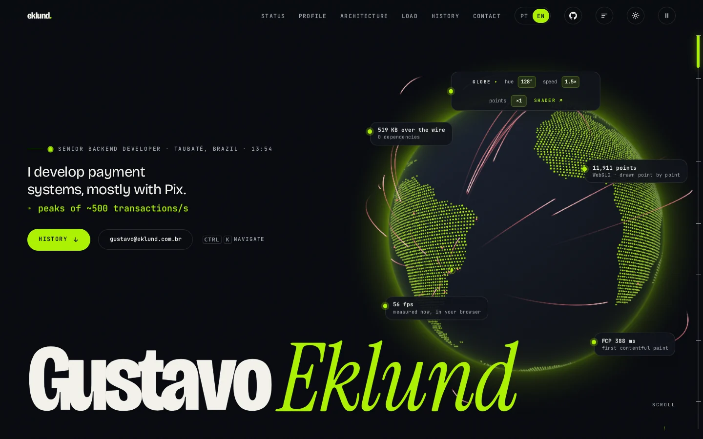
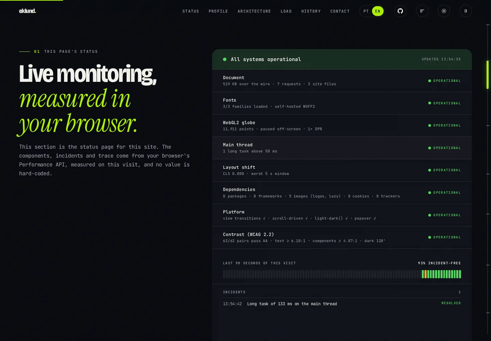
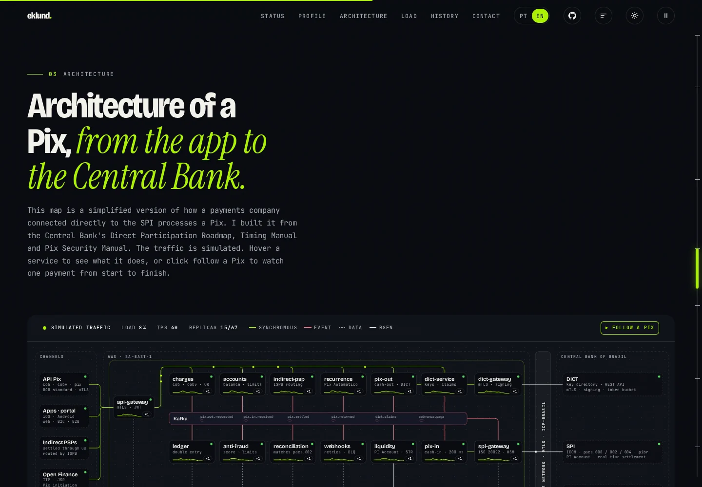
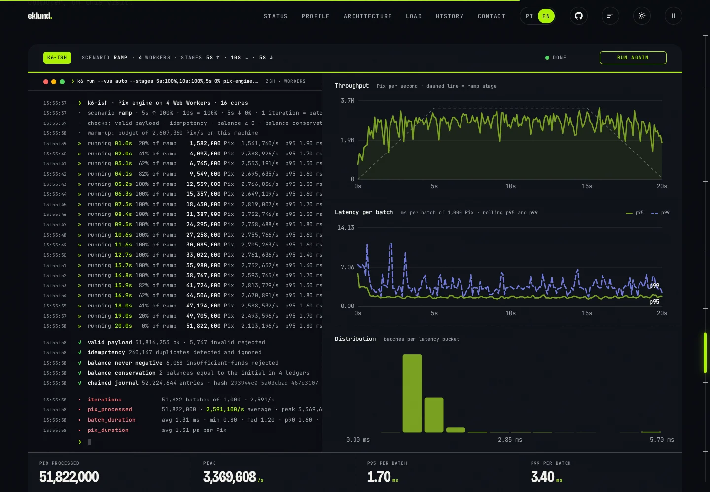
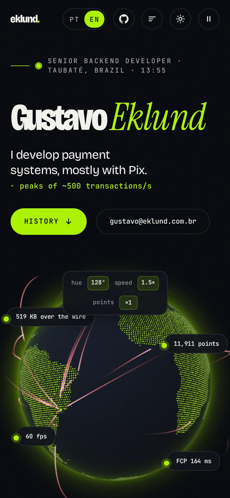
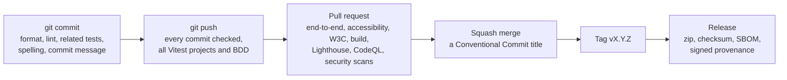

<div align="center">

# eklund.com.br

**The source of my personal website, built with plain HTML, CSS and JavaScript, and open for anyone to read.**

[English](README.md) · [Português](README.pt-BR.md) · [**Live site**](https://eklund.com.br) · [Changelog](CHANGELOG.md) · [Docs](docs/README.md)

<a href="https://github.com/GustavoEklund/eklund.com.br/actions/workflows/ci.yml"></a>
<a href="https://github.com/GustavoEklund/eklund.com.br/actions/workflows/codeql.yml"></a>
<a href="https://scorecard.dev/viewer/?uri=github.com/GustavoEklund/eklund.com.br"></a>
<a href="https://github.com/GustavoEklund/eklund.com.br/releases"></a>
<a href="https://eklund.com.br"></a>

<a href="docs/accessibility.md"></a>
<a href="https://www.conventionalcommits.org/en/v1.0.0/"></a>
<a href="CHANGELOG.md"></a>
<a href="https://semver.org/spec/v2.0.0.html"></a>
<a href="LICENSE"></a>
<a href="NOTICE.md"></a>

<a href="https://viteplus.dev"></a>
<a href="https://playwright.dev"></a>
<a href="https://pnpm.io"></a>
<a href="https://dependabot.com"></a>

<br>

<picture>
  <source media="(prefers-color-scheme: light)" srcset="docs/images/hero-light.webp">
  
</picture>

</div>

## What this is

This is the code of [eklund.com.br](https://eklund.com.br). I develop payment systems, mostly with Pix, and I wanted the site to show how I work. So the page measures itself, runs a small Pix engine in your browser and explains the architecture of a direct Pix participant, and the code behind it is tested, accessible, secured and public.

It has no framework and no runtime dependency. Every one of its 66 JavaScript modules is a class, the layout of the folders says what the site does, and the standards it claims to meet are checked by tests that fail when they stop being true.

## A tour of the page

<table>
  <tr>
    <td width="50%" valign="top">
      <a href="https://eklund.com.br/#status"></a>
      <b>A status page for the page itself.</b> Document size, fonts, frame rate of the globe, long tasks, layout shift, dependencies, platform support and color contrast are read live from the browser's Performance API. Nothing on it is hard-coded.
    </td>
    <td width="50%" valign="top">
      <a href="https://eklund.com.br/#arquitetura"></a>
      <b>An architecture map.</b> The services of a direct participant in the Brazilian instant payment system, drawn in SVG from the Central Bank's manuals, with simulated traffic, replicas on hover and a mode that follows one Pix from start to finish.
    </td>
  </tr>
  <tr>
    <td width="50%" valign="top">
      <a href="https://eklund.com.br/#carga"></a>
      <b>A load test that runs in your browser.</b> A simplified Pix engine, also written for this site, runs in Web Workers and takes payments through a ramp. It rejects duplicates, tracks balances, writes a hash-chained journal and checks that money is conserved.
    </td>
    <td width="50%" valign="top" align="center">
      <br>
      <b>The same page on a phone.</b> It works from 320 px wide, with the keyboard, at 200% text size, with reduced motion, in two languages and in two themes.
    </td>
  </tr>
</table>

There is also a trace viewer for how the page loaded, an observability dashboard, a command palette (<kbd>Ctrl</kbd> + <kbd>K</kbd>), a theme with 361 accent hues, and a globe whose shader source you can read on the page.

## By the numbers

Each number can be checked with the command beside it.

| What                        | Value                                                                                                                                                                  | Check it                                                       |
| --------------------------- | ---------------------------------------------------------------------------------------------------------------------------------------------------------------------- | -------------------------------------------------------------- |
| Runtime dependencies        | **0**: no framework, no library, no cookies, no request to another host                                                                                                | `pnpm run build` and open `dist/`                              |
| Cold load, production build | **7** requests, **282 kB** over the wire (brotli), 185 kB of it fonts                                                                                                  | `pnpm run measure:build`                                       |
| Layout shift                | **0**, in both languages and on a phone                                                                                                                                | `pnpm run test:e2e`                                            |
| Lighthouse, mobile profile  | **100** accessibility, **100** SEO, **96** best practices, **80** performance, median of five                                                                          | the `Lighthouse` job of CI                                     |
| Accessibility               | **WCAG 2.2 A and AA**, every criterion listed with its test; contrast at AA for **361 hues in 2 themes**                                                               | `pnpm run a11y` and `pnpm run contrast`                        |
| Tests                       | **2,245** unit, property, component, integration, contract, architecture and build tests, **79** behavior scenarios, **616** browser tests; **98.6%** of lines covered | `pnpm test` and `pnpm run coverage`                            |
| W3C HTML validation         | **0** findings on both pages, source and built                                                                                                                         | `pnpm run validate:html`                                       |
| Languages                   | Portuguese at `/` and English at `/en/`, each its own page                                                                                                             | [`docs/internationalization.md`](docs/internationalization.md) |

## How it is built

- **Everything is a class**, even a helper (a class with static methods), and the folders are named after what the site does (`globe`, `status-page`, `load-test`), never after a technique. Architecture tests and dependency-cruiser fail on a loose function, a feature that imports another feature, or a file named like a tracker. [`docs/architecture.md`](docs/architecture.md)
- **Tests are exact.** `toBe` or `toStrictEqual` with the whole value, in order, and lint rules that reject the loose matchers. The browser tests run on software GL, so the WebGL checks are the same on every machine. [`docs/testing.md`](docs/testing.md)
- **Standards are tests.** The Content-Security-Policy and the other headers are written once and compared with what the server sends. Contrast is computed from real styles at every hue. The structured data goes through a JSON-LD processor. [`docs/web-standards.md`](docs/web-standards.md)
- **It ships as a Vite+ build**: one hashed script and one stylesheet instead of 90 files, measured before and after, with the cost written down too. [`docs/build-and-deploy.md`](docs/build-and-deploy.md)
- **The reasons are recorded.** Each choice that shaped the project has a short note with the alternatives and what it costs. [`docs/decisions/`](docs/decisions/)

## The gates a change goes through



Commits follow [Conventional Commits](https://www.conventionalcommits.org/en/v1.0.0/) and are spell-checked in English, and the whole repository is spell-checked in English and Brazilian Portuguese. Releases follow [Semantic Versioning](https://semver.org/spec/v2.0.0.html), with the history in a [Keep a Changelog](https://keepachangelog.com/en/1.1.0/) file. Every GitHub Action is pinned to a commit, every job asks for the least permission it needs, and dependencies arrive after a cool-down. [`docs/continuous-integration.md`](docs/continuous-integration.md)

## Run it

You need Node 24, pnpm 12 (`corepack enable`) and Java 17 for the HTML validator. [`CONTRIBUTING.md`](CONTRIBUTING.md) has the full setup.

```sh
pnpm install                  # also installs the git hooks
pnpm exec playwright install chromium
pnpm dev                      # http://127.0.0.1:8734, the source as it is, with the production headers
pnpm run build                # the production build in dist/
pnpm run preview              # builds and serves dist/ at http://127.0.0.1:8737
pnpm run verify               # what the pre-push hook runs
pnpm test                     # everything, browser tests included
```

## Where things are

```text
source/       the site: index.html, en/index.html, css/, js/<feature>/, fonts/, assets/, .htaccess
tests/        js/ mirrors source/js; integration, contract, architecture, build, features (BDD), e2e
tools/        the build, the dev server, the audits, and the commit and changelog gates
docs/         architecture, testing, build and deploy, CI, releasing, decisions, accessibility
.github/      workflows, issue forms, pull request template, code owners, rulesets, Dependabot
```

## Documentation

[Architecture](docs/architecture.md) · [Internationalization](docs/internationalization.md) · [Web standards](docs/web-standards.md) · [Accessibility statement](docs/accessibility.md) · [Testing](docs/testing.md) · [Build and deploy](docs/build-and-deploy.md) · [Continuous integration](docs/continuous-integration.md) · [Releasing](docs/releasing.md) · [Repository settings](docs/repository-settings.md) · [Decisions](docs/decisions/README.md)

## Contributing, security and conduct

Bug reports, accessibility reports and better sentences are welcome: start with [`CONTRIBUTING.md`](CONTRIBUTING.md). Please report vulnerabilities privately, as [`SECURITY.md`](SECURITY.md) describes. Everyone taking part follows the [Code of Conduct](CODE_OF_CONDUCT.md). Questions go to [`SUPPORT.md`](SUPPORT.md).

This is a personal site and not a template. You are welcome to read it, learn from it and reuse the code, and the text and the career in it are mine.

## License

The code and the documentation are under the [MIT license](LICENSE). My words and images are under [CC BY-NC-ND 4.0](https://creativecommons.org/licenses/by-nc-nd/4.0/). The fonts, the icons and the company logos keep their own terms. [`NOTICE.md`](NOTICE.md) says which is which.

## Credits

The land of the globe comes from [Natural Earth](https://www.naturalearthdata.com) (public domain). The fonts are Bricolage Grotesque, Instrument Serif and JetBrains Mono, under the SIL Open Font License. The technology icons are from [Simple Icons](https://simpleicons.org) (CC0). The architecture map follows the Banco Central do Brasil documents listed in [`docs/architecture.md`](docs/architecture.md#sources-behind-the-architecture-map). The Code of Conduct is adapted from the [Contributor Covenant](https://www.contributor-covenant.org).
