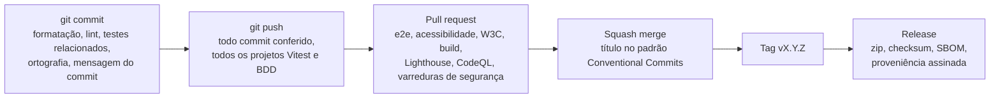

<div align="center">

# eklund.com.br

**O código-fonte do meu site pessoal, feito com HTML, CSS e JavaScript puros e aberto para qualquer pessoa ler.**

[English](README.md) · [Português](README.pt-BR.md) · [**Site no ar**](https://eklund.com.br) · [Changelog](CHANGELOG.md) · [Documentação](docs/README.md)

<a href="https://github.com/GustavoEklund/eklund.com.br/actions/workflows/ci.yml"></a>
<a href="https://github.com/GustavoEklund/eklund.com.br/actions/workflows/codeql.yml"></a>
<a href="https://scorecard.dev/viewer/?uri=github.com/GustavoEklund/eklund.com.br"></a>
<a href="https://github.com/GustavoEklund/eklund.com.br/releases"></a>
<a href="https://eklund.com.br"></a>

<a href="docs/accessibility.md"></a>
<a href="https://www.conventionalcommits.org/pt-br/v1.0.0/"></a>
<a href="CHANGELOG.md"></a>
<a href="https://semver.org/lang/pt-BR/"></a>
<a href="LICENSE"></a>
<a href="NOTICE.md"></a>

<a href="https://viteplus.dev"></a>
<a href="https://playwright.dev"></a>
<a href="https://pnpm.io"></a>
<a href="https://dependabot.com"></a>

<br>

<picture>
  <source media="(prefers-color-scheme: light)" srcset="docs/images/hero-light.webp">
  
</picture>

</div>

## O que é isto

Este é o código de [eklund.com.br](https://eklund.com.br). Eu desenvolvo sistemas de pagamento, principalmente com Pix, e queria que o site mostrasse como eu trabalho. Por isso a página mede a si mesma, roda um pequeno motor de Pix no seu navegador e explica a arquitetura de um participante direto do Pix, e o código por trás dela é testado, acessível, protegido e público.

Ele não tem framework nem dependência em tempo de execução. Cada um dos seus 66 módulos JavaScript é uma classe, a organização das pastas diz o que o site faz, e os padrões que ele afirma cumprir são verificados por testes que falham quando deixam de ser verdade.

## Um passeio pela página

<table>
  <tr>
    <td width="50%" valign="top">
      <a href="https://eklund.com.br/#status"></a>
      <b>Uma página de status da própria página.</b> Tamanho do documento, fontes, taxa de quadros do globo, tarefas longas, mudança de layout, dependências, suporte da plataforma e contraste de cor são lidos ao vivo da Performance API do navegador. Nada ali é valor fixo no código.
    </td>
    <td width="50%" valign="top">
      <a href="https://eklund.com.br/#arquitetura"></a>
      <b>Um mapa de arquitetura.</b> Os serviços de um participante direto do sistema de pagamentos instantâneos brasileiro, desenhados em SVG a partir dos manuais do Banco Central, com tráfego simulado, réplicas ao passar o mouse e um modo que acompanha um Pix do começo ao fim.
    </td>
  </tr>
  <tr>
    <td width="50%" valign="top">
      <a href="https://eklund.com.br/#carga"></a>
      <b>Um teste de carga que roda no seu navegador.</b> Um motor de Pix simplificado, também escrito para este site, roda em Web Workers e recebe pagamentos numa rampa. Ele rejeita duplicidades, controla saldos, grava um diário encadeado por hash e confere que o dinheiro se conserva.
    </td>
    <td width="50%" valign="top" align="center">
      <br>
      <b>A mesma página no celular.</b> Ela funciona a partir de 320 px de largura, pelo teclado, com texto a 200%, com movimento reduzido, em dois idiomas e em dois temas.
    </td>
  </tr>
</table>

Há ainda um visualizador de trace de como a página carregou, um painel de observabilidade, uma paleta de comandos (<kbd>Ctrl</kbd> + <kbd>K</kbd>), um tema com 361 matizes de destaque e um globo cujo código de shader você lê na própria página.

## Em números

Cada número pode ser conferido com o comando ao lado.

| O quê                             | Valor                                                                                                                                                                                                           | Como conferir                                                  |
| --------------------------------- | --------------------------------------------------------------------------------------------------------------------------------------------------------------------------------------------------------------- | -------------------------------------------------------------- |
| Dependências em tempo de execução | **0**: sem framework, sem biblioteca, sem cookies, sem requisição a outro domínio                                                                                                                               | `pnpm run build` e abra `dist/`                                |
| Carga a frio, build de produção   | **7** requisições, **282 kB** na rede (brotli), 185 kB deles de fontes                                                                                                                                          | `pnpm run measure:build`                                       |
| Mudança de layout                 | **0**, nos dois idiomas e no celular                                                                                                                                                                            | `pnpm run test:e2e`                                            |
| Lighthouse, perfil mobile         | **100** acessibilidade, **100** SEO, **96** boas práticas, **80** desempenho, mediana de cinco                                                                                                                  | o job `Lighthouse` do CI                                       |
| Acessibilidade                    | **WCAG 2.2 A e AA**, cada critério listado com seu teste; contraste AA em **361 matizes e 2 temas**                                                                                                             | `pnpm run a11y` e `pnpm run contrast`                          |
| Testes                            | **2.245** testes de unidade, de propriedade, de componente, de integração, de contrato, de arquitetura e de build, **79** cenários de comportamento, **616** testes de navegador; **98,6%** das linhas cobertas | `pnpm test` e `pnpm run coverage`                              |
| Validação HTML do W3C             | **0** achados nas duas páginas, no código-fonte e no build                                                                                                                                                      | `pnpm run validate:html`                                       |
| Idiomas                           | Português em `/` e inglês em `/en/`, cada um com a sua página                                                                                                                                                   | [`docs/internationalization.md`](docs/internationalization.md) |

## Como é feito

- **Tudo é classe**, até o auxiliar (uma classe com métodos estáticos), e as pastas têm o nome do que o site faz (`globe`, `status-page`, `load-test`), nunca o de uma técnica. Testes de arquitetura e o dependency-cruiser falham diante de uma função solta, de uma feature que importa outra feature ou de um arquivo com nome de rastreador. [`docs/architecture.md`](docs/architecture.md)
- **Os testes são exatos.** `toBe` ou `toStrictEqual` com o valor inteiro, na ordem, e regras de lint que recusam os matchers frouxos. Os testes de navegador rodam com GL por software, então as checagens de WebGL são iguais em qualquer máquina. [`docs/testing.md`](docs/testing.md)
- **Padrões são testes.** A Content-Security-Policy e os outros cabeçalhos são escritos uma vez e comparados com o que o servidor envia. O contraste é calculado a partir dos estilos reais em cada matiz. Os dados estruturados passam por um processador de JSON-LD. [`docs/web-standards.md`](docs/web-standards.md)
- **Vai para o ar como um build do Vite+**: um script e uma folha de estilo com hash no lugar de 90 arquivos, medido antes e depois, com o custo anotado também. [`docs/build-and-deploy.md`](docs/build-and-deploy.md)
- **Os motivos estão registrados.** Cada escolha que moldou o projeto tem uma nota curta com as alternativas e o que ela custa. [`docs/decisions/`](docs/decisions/)

## Os portões que uma mudança atravessa



Os commits seguem o [Conventional Commits](https://www.conventionalcommits.org/pt-br/v1.0.0/) e têm a ortografia conferida em inglês, e o repositório inteiro tem a ortografia conferida em inglês e em português do Brasil. As versões seguem o [Versionamento Semântico](https://semver.org/lang/pt-BR/), com o histórico num arquivo no formato [Keep a Changelog](https://keepachangelog.com/pt-BR/1.1.0/). Toda GitHub Action fica fixada num commit, todo job pede a menor permissão de que precisa, e as dependências chegam depois de um período de espera. [`docs/continuous-integration.md`](docs/continuous-integration.md)

## Como rodar

Você precisa de Node 24, pnpm 12 (`corepack enable`) e Java 17 para o validador de HTML. O [`CONTRIBUTING.md`](CONTRIBUTING.md) tem a configuração completa (em inglês).

```sh
pnpm install                  # também instala os git hooks
pnpm exec playwright install chromium
pnpm dev                      # http://127.0.0.1:8734, o código-fonte como está, com os cabeçalhos de produção
pnpm run build                # o build de produção em dist/
pnpm run preview              # faz o build e serve dist/ em http://127.0.0.1:8737
pnpm run verify               # o que o hook de pre-push executa
pnpm test                     # tudo, inclusive os testes de navegador
```

## Onde está cada coisa

```text
source/       o site: index.html, en/index.html, css/, js/<feature>/, fonts/, assets/, .htaccess
tests/        js/ espelha source/js; integration, contract, architecture, build, features (BDD), e2e
tools/        o build, o servidor de desenvolvimento, as auditorias e os portões de commit e de changelog
docs/         arquitetura, testes, build e deploy, CI, releases, decisões, acessibilidade
.github/      workflows, formulários de issue, modelo de pull request, code owners, rulesets, Dependabot
```

## Documentação

A documentação está em inglês: [Arquitetura](docs/architecture.md) · [Internacionalização](docs/internationalization.md) · [Padrões web](docs/web-standards.md) · [Declaração de acessibilidade](docs/accessibility.md) · [Testes](docs/testing.md) · [Build e deploy](docs/build-and-deploy.md) · [Integração contínua](docs/continuous-integration.md) · [Releases](docs/releasing.md) · [Configurações do repositório](docs/repository-settings.md) · [Decisões](docs/decisions/README.md)

## Contribuir, segurança e conduta

Relatos de bug, relatos de acessibilidade e frases melhores são bem-vindos: comece pelo [`CONTRIBUTING.md`](CONTRIBUTING.md). Relate vulnerabilidades em particular, como descreve o [`SECURITY.md`](SECURITY.md). Todas as pessoas que participam seguem o [Código de Conduta](CODE_OF_CONDUCT.md). Dúvidas vão para o [`SUPPORT.md`](SUPPORT.md).

Este é um site pessoal e não um template. Você pode ler, aprender e reaproveitar o código, e os textos e a carreira que estão nele são meus.

## Licença

O código e a documentação estão sob a [licença MIT](LICENSE). Meus textos e imagens estão sob a [CC BY-NC-ND 4.0](https://creativecommons.org/licenses/by-nc-nd/4.0/deed.pt-br). As fontes, os ícones e os logos de empresas mantêm os próprios termos. O [`NOTICE.md`](NOTICE.md) diz qual é qual.

## Créditos

A terra do globo vem do [Natural Earth](https://www.naturalearthdata.com) (domínio público). As fontes são Bricolage Grotesque, Instrument Serif e JetBrains Mono, sob a SIL Open Font License. Os ícones de tecnologias são do [Simple Icons](https://simpleicons.org) (CC0). O mapa de arquitetura segue os documentos do Banco Central do Brasil listados em [`docs/architecture.md`](docs/architecture.md#sources-behind-the-architecture-map). O Código de Conduta é adaptado do [Contributor Covenant](https://www.contributor-covenant.org).
