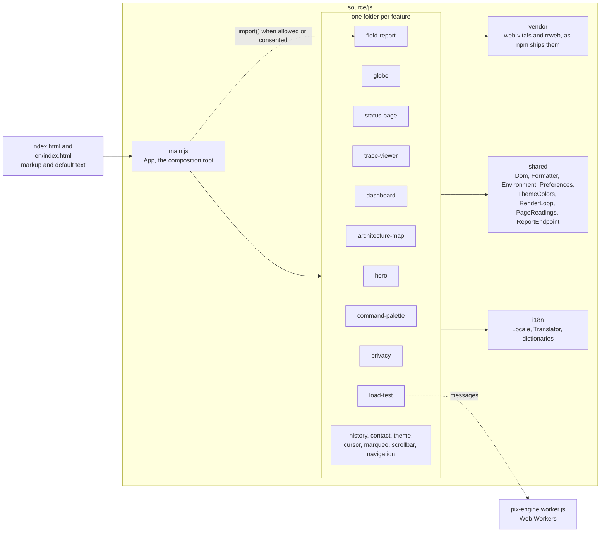
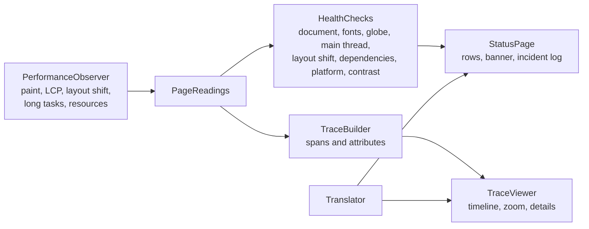

# Architecture

The site is plain HTML, CSS and JavaScript with no framework. The two libraries it runs are web-vitals and rrweb, both to measure it ([0011](decisions/0011-two-libraries-to-measure.md)). This page explains how the code is organized and why. For the decisions behind it, see [`decisions/`](decisions/).

## How the pieces fit

`main.js` builds an `App` that creates every feature, gives each one what it needs and wires them together. Features do not know each other. They share small utilities and the translator.



The arrows are rules, and `tests/architecture` fails when code breaks them: a feature imports only `shared/`, `i18n/` and the libraries of `vendor/`, `shared/` imports nothing of the site, and only `main.js` composes features.

## The privacy choice

[0010](decisions/0010-privacy-by-the-anpd-guidance.md) sets what the site asks and when, and [`privacy.md`](privacy.md) what it processes. In the code:

- `PrivacyChoice` keeps the choice in `localStorage` under `privacy`, as JSON with the version of the purposes (`PrivacyChoice.VERSION`), whether measurement and recording are on, and the moment it stops counting, six calendar months after it was saved. A choice counts while its version is the current one and its expiry is in the future. Raising the version asks every visitor again. Global Privacy Control (`navigator.globalPrivacyControl === true`) counts as refusing everything, whatever was saved, and `/.well-known/gpc.json` says the site honors it.
- The inline script in the head of `index.html` makes the same decision before the first paint and sets `data-privacy="ask"` on the root element, which is what shows the notice, so the notice never moves the layout. `tests/contract/head-script.contract.test.js` checks that the script and `PrivacyChoice` agree in every case.
- `PrivacyNotice` is the card fixed at the bottom: three buttons of the same size and style and no close button. While it shows, it writes its height to `--privacy-notice-height`, which `privacy.css` turns into `scroll-padding-bottom` on the root and room under the footer, so the focused control and the last link stay above it.
- `PrivacyDialog` is the second layer, a modal `<dialog>`. The footer link "Privacy preferences" and the command palette open it, and so does the address `/?preferencias` or `/en/?preferences`, which the legal pages link to; the app opens it and takes the query out of the address. Without scripts, the footer link leads to the part of the privacy policy about the choice, and nothing measures.
- What measures or records asks `PrivacyChoice` first (`measurementAllowed`, `recordingAllowed`) and follows `onChange`: the measurement and the recording below do. "Delete my recordings" calls the `recordings` that `App` gives the dialog, `{ held(), deleteAll() }`, backed by `RecordingCodes`: the button is enabled while the browser keeps a code, the note beside it says whether it does, and a deletion that fails says so and keeps the codes for another try. `PrivacyDialog.NO_RECORDINGS`, which holds none, is the default for a dialog without them.

## What the page sends about itself

The anonymous measurement of [0009](decisions/0009-measurement-on-a-cloudflare-worker.md) and [0010](decisions/0010-privacy-by-the-anpd-guidance.md) lives in `field-report/`. What a page may send is `tests/contract/schemas/page-report.schema.json`: a contract test on the collector's side (`page-report.provider`) and one on the page's side (`page-report.consumer`) hold both to it.

- `App` loads `field-report/field-report.js`, and with it web-vitals, through a dynamic import, once the page has loaded and the main thread is idle (`requestIdleCallback`, four seconds at most), and only while `PrivacyChoice.measurementAllowed`. A visitor who refused, or whose browser sends Global Privacy Control, downloads none of it. A refusal later stops it at once (`stop()`), and allowing it again starts it again. The production build turns the module and web-vitals into one chunk of its own, and the helpers it shares with the recording (`SiteVersion`, `PageAddress`, `DeviceRanges`) into a small one, which no page preloads.
- `FieldReport` puts the parts together: web-vitals' `onLCP`, `onINP`, `onCLS`, `onFCP` and `onTTFB` with attribution, reduced by `VitalSummary` to the fields the contract allows; `PageErrors` for uncaught errors in the site's own files, unhandled rejections, Content-Security-Policy violations, deprecations and interventions; `PageActivity` for the sections reached, the links that leave the site, the first touch of the globe, the map, the trace and the history, and rage clicks; and `record(name, detail, value)`, which `App` calls for what the features do (the palette, its commands, the theme, the color, the language, the pause button, copying the address, the load test). `DeviceRanges` turns the device into ranges, and `ReportText` puts every text and number in the form the collector accepts.
- `LoadReport` is one page load: a random UUID made in memory (`crypto.randomUUID()`), never stored, and the report that grows as the load goes on, with `seq` counting up. It goes out with `fetch`, as `text/plain` with `keepalive`, no credentials and no referrer, each time the page hides (`visibilitychange`, then `pagehide`), and only when there is something new. Events and errors go once; each metric goes with its latest value. A load restored from the back/forward cache is a new load.
- `ReportEndpoint` says where: from eklund.com.br and gustavo.eklund.com.br, the collector on workers.dev; from a development server on this machine (plain HTTP on 127.0.0.1), the one `pnpm run edge:dev` runs; from anywhere else, such as the build Lighthouse loads over HTTPS, nowhere, though everything else runs. `tools/site-headers.mjs` reads the same origins for `connect-src`. The end-to-end and BDD suites answer for the local collector and cut off the one online.
- `SiteVersion` is the release the reports name; `pnpm run changelog release` writes it with `package.json`, and a contract test keeps them equal.

## What the page records, with consent

The session recording and the heat map of [0010](decisions/0010-privacy-by-the-anpd-guidance.md) also live in `field-report/`, in a chunk of their own. What a chunk may carry is `tests/contract/schemas/session-chunk.schema.json`, and what a deletion may carry is `session-deletion.schema.json`, each held by a test on the collector's side (`session-recording.provider`) and one on the page's side (`session-recording.consumer`).

- `App` loads `field-report/session-recording.js`, and with it rrweb's recorder (`vendor/record.js`), through a dynamic import once the page is idle, and only while `PrivacyChoice.recordingAllowed`. Withdrawing consent stops it at once and has every recording of the browser deleted; consenting again starts a new one. "Delete my recordings" does the same and leaves the page without a recording until the next load or a new consent.
- `SessionRecording` is one page load: a new code (`crypto.randomUUID()`), which `RecordingCodes` (in `privacy/`) keeps in `localStorage` under `recordings` for 30 days, and rrweb recording with every field masked to an empty text, so neither what was typed nor its length is kept, the custom cursor, the command palette and the shaders' code blocked, no canvas drawn, the pointer sampled every 100 ms and scrolling every 150 ms. `RecordingBatch` writes each event as JSON once, takes the query and fragment out of the page's address, and cuts what waits into chunks numbered from 0 within the collector's limits. A chunk goes as gzip (`CompressionStream`) every ten seconds, or at once past 256 kB of text, which the first one with the whole page always is, and what is left goes as plain text with keepalive when the page hides. No content type, so no preflight; no credentials and no referrer.
- `ClickPlaces` says where a pointer click landed for the heat map: the part of the page from a closed list (the privacy notice and dialog, the header, each section by its id, the footer, or `other`, against the window), the range of the window's width from `DeviceRanges`, and the position inside that part as a share of its width and height, to a thousandth. A click of the keyboard, or one a script made, is not placed.
- `stop()` drops what was not sent and resolves once the chunks on their way have arrived, so the deletion that follows reaches all of them. `RecordingCodes.deleteAll()` sends the codes, 50 a request, to `/v1/session/delete`, and forgets each code once the collector answers.
- `ReportEndpoint` (in `shared/`, since the privacy preferences use it too) gives the address of each route, and `PageAddress` the page, without the folder of its release.

## What the page measures about itself

The status page and the trace viewer do not use a monitoring service. They read the browser's Performance API.



## Layout (screaming architecture)

The site is `source/`, its tests are `tests/`, and the folders under `tests/js/` mirror the ones under `source/js/`. Folders are named after what the site does, not after techniques. Every module is a class; pure helpers are classes with static methods.

```
source/                    everything that is deployed
  index.html               markup only; the text it shows is the pt-BR default, translated at runtime (see Internationalization)
  en/                      index.html (the same page with its text in en-US, generated by tools/i18n-check.mjs --fix-html) and the .htaccess that says it is English
  assets/                  company logos, icons.svg (Simple Icons sprite), brand/ (manifest icons, the social card)
  fonts/                   the three families as WOFF2, with their SIL OFL license texts
  css/
    foundation/            tokens (layers, colors, fonts), layout, shared components, effects
    <feature>.css          hero, marquee, status-page, trace-viewer, profile, charts, dashboard,
                           architecture-map, load-test, history, contact, command-palette, scrollbar, cursor, locale-switcher,
                           language-offer, privacy
  js/
    main.js                App: composition root, wires every feature
    shared/                Dom, Numbers, SeededRandom, Formatter, Environment, Preferences,
                           ThemeColors, RenderLoop, PageReadings, ChartScales, SvgPaths, ReportEndpoint
    globe/                 Globe, GlobeShaders, LandDecoder, GlobeGeometry, WebGlProgram, GlobeControls, ShaderDialog
    status-page/           HealthCheck subclasses, StatusPage
    trace-viewer/          TraceBuilder, TraceViewer
    dashboard/             SyntheticDaySeries, LinePanel, UptimeStrip, HourlyTable, ObservabilityDashboard
    architecture-map/      Diagram, OrthogonalPath, TrafficSimulation, PixWalkthrough, ArchitectureMap
    load-test/             PixEngine, pix-engine.worker.js (the Web Worker shell), RampScenario, SeriesResampler,
                           LoadTestCharts, TerminalLog, WorkerPool, LoadTest
    i18n/                  Locale, Translator, LocaleSwitcher, Dictionaries, locales/pt-br.js, locales/en-us.js
    privacy/               PrivacyChoice, PrivacyNotice, PrivacyDialog, RecordingCodes (see The privacy choice)
    field-report/          FieldReport, LoadReport, VitalSummary, PageErrors, PageActivity, DeviceRanges, ReportText,
                           PageAddress, SiteVersion (see What the page sends about itself); SessionRecording, RecordingBatch,
                           ClickPlaces (see What the page records, with consent)
    vendor/                web-vitals.attribution.js and rrweb's record.js, each with its map and license, npm's files as
                           they are, outside the class rule, the formatter and the rule of a test per module (docs/decisions/0011)
    history/ contact/ command-palette/ theme/ cursor/ hero/ marquee/ scrollbar/ navigation/
  .htaccess                security headers, cache and compression rules for Hostinger
  robots.txt sitemap.xml site.webmanifest icon.svg favicon.ico apple-touch-icon.png .well-known/security.txt .well-known/gpc.json
  <key>.txt                the IndexNow key, a file named after its content (tools/index-now.mjs)
  privacidade/ cookies/ termos/   the legal pages in Portuguese, and en/privacy/, en/cookies/, en/terms/ in English: static HTML with
                           one stylesheet, css/legal.css, and the head script of index.html (docs/decisions/0014)
  404.html en/404.html     the pages a missing address answers with, status 404, named by ErrorDocument in the root .htaccess and
                           in en/.htaccess; built like the legal pages, with noindex and every address from the root (docs/decisions/0016)
edge/                      the collector of real visits, a Cloudflare Worker on workers.dev (docs/decisions/0009); no site code
  src/                     Router, Collector, PageReport and ReportVocabulary (the contract it reads), VisitorAgent, SendLimit and
                           DailyCeiling (how much one client may send in a minute, and how many rows and bytes a day), ReportStore (D1),
                           RecordingInbox, SessionChunk, DeletionRequest, Gzip and RecordingStore (the recordings, with consent:
                           chunks into R2, a row for each recording and click into D1, deletion by code),
                           Retention (daily totals and deletions), UptimeMonitor and IncidentIssues (the site checked every five
                           minutes, an issue when a page is down), LabInbox, LabBatch and LabStore (what the nightly lab job sends,
                           behind LAB_TOKEN: rows into D1, full reports into R2), Replies, Calendar; the readings (docs/decisions/0013):
                           GithubSignIn (the OAuth sign-in through GitHub), ReadingHandler (/mcp and /api/v1 for an allowed login),
                           ReadingServer (the MCP tools), ReadingApi (the same as JSON), ReadingInputs (their closed inputs),
                           ReadingQueries (read-only D1), MannWhitney, ChangePoints and Sample; index.js wires them to the requests
                           and the Cron Triggers, with the OAuth provider in front of everything but the public routes
  migrations/              the D1 schema, applied by wrangler before each deploy
  wrangler.jsonc           the Worker: D1 and R2 in the EU jurisdiction, KV for the OAuth provider, the Cron Triggers, the origins
                           that may send, the GitHub logins that may read, no request logs
  panel/                   my private panel, a second Worker behind Cloudflare Access (docs/decisions/0015): AccessCheck and
                           AccessKeys (its own check of the Access token: RS256 against the team's keys, AUD, issuer, expiry, email),
                           ReadOnlyBindings (the collector's D1 and R2, only to read), PanelRouter, one page class per section
                           (OverviewPage, VitalsPage, EventsPage, LabPage, RecordingsPage, ReplayPage, HeatMapPage) over
                           ReadingQueries, PanelLayout and PanelHtml (the page, its headers and escaping), SvgChart (inline SVG),
                           PanelQuery, PanelFormat, ReleaseOrder; browser/ holds its stylesheet and ReplayPlayer, the one script,
                           and vendor/ rrweb's replayer as npm ships it, which only the panel serves
  panel.wrangler.jsonc     the panel's Worker: the same D1 and R2, the Access team, the rules that import its files as text
tests/
  js/<feature>/<module>.<kind>.test.js   unit, property and component tests, beside the module they test
  edge/<module>.edge.test.js             the tests of the collector and the panel, beside their modules; each Worker runs in workerd
  integration/ contract/ architecture/ features/ e2e/   cross-cutting suites (see Tests)
  support/                 helpers shared by the suites (fake WebGL context, recording canvas, dictionary text, site reader)
tools/
  serve.mjs                static server for source/ (dev and E2E), no dependencies; sends the same security headers as .htaccess,
                           and answers a missing address with the 404 page of its language, as the ErrorDocument lines do
  site-headers.mjs         SiteHeaders: the Content-Security-Policy, the other headers and the cache rules, shared by .htaccess (checked by a test), serve.mjs and production-server.mjs
  production-server.mjs    serves a folder as the hosting does (HTTP/2 over TLS, brotli, the production headers and cache rules); Lighthouse CI and measure-build.mjs load the build through it
  render-brand-assets.mjs  renders favicon.ico, the touch and manifest icons and the social card from icon.svg and the fonts
  schema-org-subset.mjs    extracts the schema.org types and properties the JSON-LD uses into a test fixture
  i18n-check.mjs           audits the dictionaries (same keys and placeholders in both languages, every referenced key defined, none unused) and writes or checks index.html's defaults and en/index.html
  legal-pages.mjs          the six legal pages, and the head script that i18n-check.mjs copies into them from index.html
  not-found-pages.mjs      the two 404 pages, and which one answers for a missing address (serve.mjs and production-server.mjs)
  html-defaults.mjs        reads the dictionaries and writes the default text of a page from them; english-page.mjs turns index.html into en/index.html
  land.py                  rasterizes Natural Earth land polygons into the latitude-ring bitset (source/js/globe/land-bitset.js)
  preview.mjs              screenshots, clicks, drags and runtime exceptions through the Chrome DevTools Protocol
  measure-sections.mjs     measures the off-screen sections at many widths in both languages and prints the `contain-intrinsic-size` rules for layout.css
  site-build.mjs           the parts of the production build that Vite+ does not do itself (see Build and deploy)
  measure-build.mjs        loads the page from source/ and from dist/ in several network and CPU conditions and prints what the build saves
  deploy.mjs               puts a release online over FTP with TLS, and compares the pages online with it (the Deploy workflow)
  lab-run.mjs              the nightly lab job: PageSpeed Insights, CrUX, Search Console, Bing Webmaster Tools and the certificates, sent to the collector (the Lab workflow)
  index-now.mjs            tells the IndexNow engines that a release changed the pages (the last job of the Release workflow)
vite.config.js             Vitest projects (one per kind of test) and the strict lint rules for tests/
vite.build.config.js       the production build (Vite+): source/ in, dist/ out; dist/ is generated and not in git
playwright.config.js  cucumber.mjs  stryker.config.mjs  .dependency-cruiser.cjs
```

## Conventions

- Code, comments and identifiers in English. Comments only where they add intent.
- Classes everywhere: dependencies in the constructor, side effects in `mount()` / `install()` / `start()`. The one exception is `vendor/`, which holds npm's files as they are.
- CSS classes are descriptive (`.job-card`, `.status-badge`), state is `is-*`, tokens live in `css/foundation/tokens.css` (`--hue` recolors the whole site).
- Performance rules: no `backdrop-filter` on fixed elements, no full-screen `mix-blend-mode` overlays, canvas strokes batched, `will-change` on marquee tracks, DOM written only on change, every loop pauses off-screen (`RenderLoop`).
- Layout-stability rules (CLS is measured live on the status page and stays at 0.000 on a normal load in both languages): no `scroll-behavior: smooth` on the root (it animates the initial fragment jump; `AnchorLinks` does smooth scrolling on clicks instead); every box the JS fills has its final size in the markup or CSS (`viewBox` on the SVG map, `aspect-ratio`/`height` on chart plots, `min-height` on the status components, incident log and trace rows, static summary tiles); the load-test terminal uses `contain: size` so logging never changes the row height; text that depends on the display fonts (hero, marquee, nav) stays hidden until `fonts-ready`; the `contain-intrinsic-size` placeholders of the off-screen sections are content-box heights (Chrome adds the section padding and border on top), follow the width of the window as `calc(A + B vw)` lines between the layout switches, and have English variants under `:lang(en)`; they are generated by `tools/measure-sections.mjs`. Known limit: a deep link such as `/#carga` can still shift, because Chrome scrolls to the fragment while the first layout is unsettled and the display font swaps in.
- Popovers: the custom cursor (`.cursor-dot`, `.cursor-ring`) and the copy toast are popovers so they live in the top layer above modal dialogs. Never style the bare `[popover]` selector; give each its own class (`.toast`), or every popover inherits it.
- Copy voice: plain words, first person, concrete facts. No slogans, no "X, not Y" contrasts, no metaphors in headings (a heading says what the section is or what it shows), no em-dashes. Say a Banco Central term in everyday words the first time it appears (SPI is "the Central Bank system that settles Pix"). Say each number once where it matters instead of repeating it in every section. Claim no more than the CV supports: "we" for what the team delivered, "I" for what was done alone, never "I build the company's system". The headline and the page description say what the person does, never where he works: employers belong in the experience section. A heading in a showcase section names the skill the section demonstrates, because the large heading is what the eye reads first and the lead underneath is small and dim. No bold in running text. Write round large numbers in words ("2 milhões", "2 million"), because a string of zeros with dots or commas is easy to misread by a factor of ten.
- File names are what ad blockers match (EasyPrivacy has the rule `/performance-metrics.js`), so no file uses tracker words (metrics, analytics, stats, tracking, telemetry, performance, beacon, pixel…); an architecture test enforces it and `pnpm run adblock` checks the site against the real EasyList, EasyPrivacy and uBlock Origin lists (network rules and element-hiding rules, both languages). Run it before a deploy.
- UI text lives in the dictionaries, never in code: no Portuguese or English sentence in a `.js` file outside `source/js/i18n/locales/`. The legal pages are the one exception, written in HTML in each language ([0014](decisions/0014-legal-pages-written-in-html.md)). Numbers and times go through `Formatter`, never `toLocale*` or a hard-coded locale.

## Regenerate the globe data

```sh
curl -sL -o /tmp/land.geojson https://raw.githubusercontent.com/nvkelso/natural-earth-vector/master/geojson/ne_110m_land.geojson
python3 tools/land.py /tmp/land.geojson 180 2880 1440 /tmp/land.json
# then paste `bits` into LAND_BITSET_BASE64 and `R` into LAND_RING_COUNT in source/js/globe/land-bitset.js
```

## Sources behind the architecture map

Roteiro para Participação Direta no SPI, Manual de Tempos do Pix, Manual de Segurança do SFN vol. II, API DICT 2.12 and the Catálogo de Serviços do SFN vol. VI, all from the Banco Central do Brasil.
