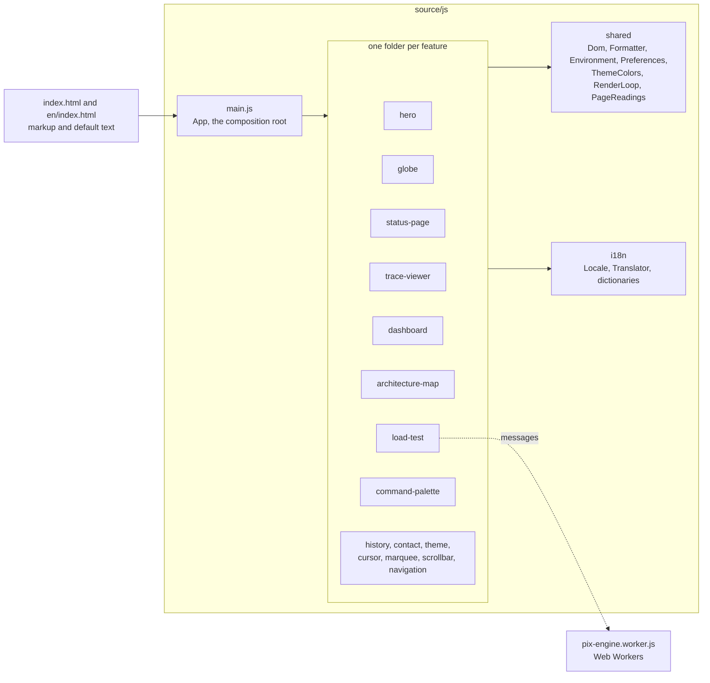
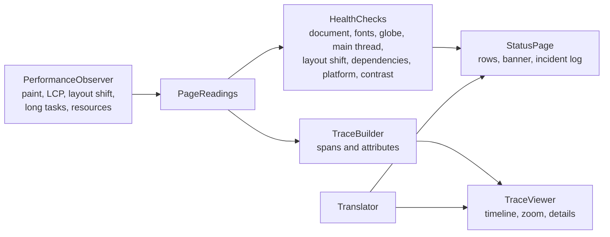

# Architecture

The site is plain HTML, CSS and JavaScript with no framework and no runtime dependency. This page explains how the code is organized and why. For the decisions behind it, see [`decisions/`](decisions/).

## How the pieces fit

`main.js` builds an `App` that creates every feature, gives each one what it needs and wires them together. Features do not know each other. They share small utilities and the translator.



The arrows are rules, and `tests/architecture` fails when code breaks them: a feature imports only `shared/` and `i18n/`, `shared/` imports nothing of the site, and only `main.js` composes features.

## What the page measures about itself

The status page and the trace viewer do not use a monitoring service. They read the browser's Performance API.



## Layout (screaming architecture)

The site is `source/`, its tests are `tests/`, and the folders under `tests/js/` mirror the ones under `source/js/`. Folders are named after what the site does, not after techniques. Every module is a class; pure helpers are classes with static methods.

```
source/                    everything that is deployed
  index.html               markup only; the text it shows is the pt-BR default, translated at runtime (see Internationalization)
  en/                      index.html (the same page with its text in en-US, generated by tools/i18n-check.mjs --fix-html) and the .htaccess that says it is English
  assets/                  company logos, icons.svg (Simple Icons sprite), brand/ (manifest icons, the social card)
  fonts/                   the three families as WOFF2, with their SIL OFL license texts
  css/
    foundation/            tokens (layers, colors, fonts), layout, shared components, effects
    <feature>.css          hero, marquee, status-page, trace-viewer, profile, charts, dashboard,
                           architecture-map, load-test, history, contact, command-palette, scrollbar, cursor, locale-switcher
  js/
    main.js                App: composition root, wires every feature
    shared/                Dom, Numbers, SeededRandom, Formatter, Environment, Preferences,
                           ThemeColors, RenderLoop, PageReadings, ChartScales, SvgPaths
    globe/                 Globe, GlobeShaders, LandDecoder, GlobeGeometry, WebGlProgram, GlobeControls, ShaderDialog
    status-page/           HealthCheck subclasses, StatusPage
    trace-viewer/          TraceBuilder, TraceViewer
    dashboard/             SyntheticDaySeries, LinePanel, UptimeStrip, HourlyTable, ObservabilityDashboard
    architecture-map/      Diagram, OrthogonalPath, TrafficSimulation, PixWalkthrough, ArchitectureMap
    load-test/             PixEngine, pix-engine.worker.js (the Web Worker shell), RampScenario, SeriesResampler,
                           LoadTestCharts, TerminalLog, WorkerPool, LoadTest
    i18n/                  Locale, Translator, LocaleSwitcher, Dictionaries, locales/pt-br.js, locales/en-us.js
    history/ contact/ command-palette/ theme/ cursor/ hero/ marquee/ scrollbar/ navigation/
  .htaccess                security headers, cache and compression rules for Hostinger
  robots.txt sitemap.xml site.webmanifest icon.svg favicon.ico apple-touch-icon.png .well-known/security.txt
edge/                      the collector of real visits, a Cloudflare Worker on workers.dev (docs/decisions/0009); no site code
  src/                     Router, Collector, PageReport and ReportVocabulary (the contract it reads), VisitorAgent, ReportStore (D1),
                           Retention (daily totals and deletions, from the Cron Trigger), Replies, Calendar; index.js wires them
  migrations/              the D1 schema, applied by wrangler before each deploy
  wrangler.jsonc           the Worker: D1 in the EU jurisdiction, the Cron Trigger, the origins that may send, no request logs
tests/
  js/<feature>/<module>.<kind>.test.js   unit, property and component tests, beside the module they test
  edge/<module>.edge.test.js             the collector's tests, beside its modules; the Worker runs in workerd through wrangler
  integration/ contract/ architecture/ features/ e2e/   cross-cutting suites (see Tests)
  support/                 helpers shared by the suites (fake WebGL context, recording canvas, dictionary text, site reader)
tools/
  serve.mjs                static server for source/ (dev and E2E), no dependencies; sends the same security headers as .htaccess
  site-headers.mjs         SiteHeaders: the Content-Security-Policy and the other headers, shared by .htaccess (checked by a test) and serve.mjs
  render-brand-assets.mjs  renders favicon.ico, the touch and manifest icons and the social card from icon.svg and the fonts
  schema-org-subset.mjs    extracts the schema.org types and properties the JSON-LD uses into a test fixture
  i18n-check.mjs           audits the dictionaries (same keys and placeholders in both languages, every referenced key defined, none unused) and writes or checks index.html's defaults and en/index.html
  html-defaults.mjs        reads the dictionaries and writes the default text of a page from them; english-page.mjs turns index.html into en/index.html
  land.py                  rasterizes Natural Earth land polygons into the latitude-ring bitset (source/js/globe/land-bitset.js)
  preview.mjs              screenshots, clicks, drags and runtime exceptions through the Chrome DevTools Protocol
  measure-sections.mjs     measures the off-screen sections at many widths in both languages and prints the `contain-intrinsic-size` rules for layout.css
  site-build.mjs           the parts of the production build that Vite+ does not do itself (see Build and deploy)
  measure-build.mjs        loads the page from source/ and from dist/ in several network and CPU conditions and prints what the build saves
  deploy.mjs               puts a release online over FTP with TLS, and compares the pages online with it (the Deploy workflow)
vite.config.js             Vitest projects (one per kind of test) and the strict lint rules for tests/
vite.build.config.js       the production build (Vite+): source/ in, dist/ out; dist/ is generated and not in git
playwright.config.js  cucumber.mjs  stryker.config.mjs  .dependency-cruiser.cjs
```

## Conventions

- Code, comments and identifiers in English. Comments only where they add intent.
- Classes everywhere: dependencies in the constructor, side effects in `mount()` / `install()` / `start()`.
- CSS classes are descriptive (`.job-card`, `.status-badge`), state is `is-*`, tokens live in `css/foundation/tokens.css` (`--hue` recolors the whole site).
- Performance rules: no `backdrop-filter` on fixed elements, no full-screen `mix-blend-mode` overlays, canvas strokes batched, `will-change` on marquee tracks, DOM written only on change, every loop pauses off-screen (`RenderLoop`).
- Layout-stability rules (CLS is measured live on the status page and stays at 0.000 on a normal load in both languages): no `scroll-behavior: smooth` on the root (it animates the initial fragment jump; `AnchorLinks` does smooth scrolling on clicks instead); every box the JS fills has its final size in the markup or CSS (`viewBox` on the SVG map, `aspect-ratio`/`height` on chart plots, `min-height` on the status components, incident log and trace rows, static summary tiles); the load-test terminal uses `contain: size` so logging never changes the row height; text that depends on the display fonts (hero, marquee, nav) stays hidden until `fonts-ready`; the `contain-intrinsic-size` placeholders of the off-screen sections are content-box heights (Chrome adds the section padding and border on top), follow the width of the window as `calc(A + B vw)` lines between the layout switches, and have English variants under `:lang(en)`; they are generated by `tools/measure-sections.mjs`. Known limit: a deep link such as `/#carga` can still shift, because Chrome scrolls to the fragment while the first layout is unsettled and the display font swaps in.
- Popovers: the custom cursor (`.cursor-dot`, `.cursor-ring`) and the copy toast are popovers so they live in the top layer above modal dialogs. Never style the bare `[popover]` selector; give each its own class (`.toast`), or every popover inherits it.
- Copy voice: plain words, first person, concrete facts. No slogans, no "X, not Y" contrasts, no metaphors in headings (a heading says what the section is or what it shows), no em-dashes. Say a Banco Central term in everyday words the first time it appears (SPI is "the Central Bank system that settles Pix"). Say each number once where it matters instead of repeating it in every section. Claim no more than the CV supports: "we" for what the team delivered, "I" for what was done alone, never "I build the company's system". The headline and the page description say what the person does, never where he works: employers belong in the experience section. A heading in a showcase section names the skill the section demonstrates, because the large heading is what the eye reads first and the lead underneath is small and dim. No bold in running text. Write round large numbers in words ("2 milhões", "2 million"), because a string of zeros with dots or commas is easy to misread by a factor of ten.
- File names are what ad blockers match (EasyPrivacy has the rule `/performance-metrics.js`), so no file uses tracker words (metrics, analytics, stats, tracking, telemetry, performance, beacon, pixel…); an architecture test enforces it and `pnpm run adblock` checks the site against the real EasyList, EasyPrivacy and uBlock Origin lists (network rules and element-hiding rules, both languages). Run it before a deploy.
- UI text lives in the dictionaries, never in code: no Portuguese or English sentence in a `.js` file outside `source/js/i18n/locales/`. Numbers and times go through `Formatter`, never `toLocale*` or a hard-coded locale.

## Regenerate the globe data

```sh
curl -sL -o /tmp/land.geojson https://raw.githubusercontent.com/nvkelso/natural-earth-vector/master/geojson/ne_110m_land.geojson
python3 tools/land.py /tmp/land.geojson 180 2880 1440 /tmp/land.json
# then paste `bits` into LAND_BITSET_BASE64 and `R` into LAND_RING_COUNT in source/js/globe/land-bitset.js
```

## Sources behind the architecture map

Roteiro para Participação Direta no SPI, Manual de Tempos do Pix, Manual de Segurança do SFN vol. II, API DICT 2.12 and the Catálogo de Serviços do SFN vol. VI, all from the Banco Central do Brasil.
