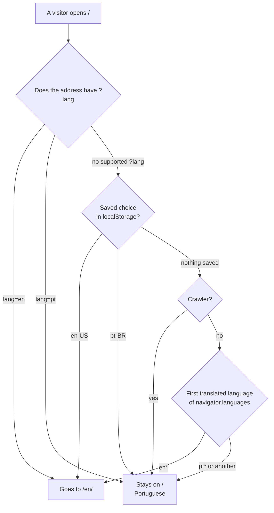

# Internationalization

Two languages, pt-BR (default) and en-US. Each has its own page, which is what lets the English one have a real canonical address: `/` is Portuguese and `/en/` is English (the same markup, with every default text written in English, so crawlers and social cards read English there). In the browser the language still switches without a reload, and the address follows.

- **Which language:** the address says which page this is. The inline script in the head of `index.html` decides, before the first paint, whether a visitor who opened `/` goes to `/en/`: `?lang=en` does (it was the old address of the English version, and the root `.htaccess` redirects it too), `?lang=pt` stays, then the visitor's saved choice (`localStorage` key `lang`, written only when they click a language link or use the palette), then the first of `navigator.languages` that the site translates (any `en*` is English, any `pt*` is Portuguese), then pt-BR. A crawler is not sent anywhere by its browser language, so the Portuguese page is the one indexed at `/`. The header has one link per language (`aria-current` marks the current one); a click switches in place and moves the address with `history.replaceState`, a click with a modifier key opens the other page.
- **Dictionaries:** `source/js/i18n/locales/pt-br.js` and `en-us.js` export one nested object each, with the same keys. Banco Central terms (SPI, DICT, Pix, pacs.008, Conta PI, ISPB, RSFN, EndToEndId…), company names and Kafka topics are not translated.
- **Markup contract** (`Translator.applyTo`): `data-i18n="key"` sets the text, `data-i18n-html="key"` sets inline markup (`<em>`, `<strong>`…), `data-i18n-attr="aria-label:key;title:key"` sets attributes (also `data-cursor`, `placeholder`). When a fragment shares its parent with other nodes, wrap it in `<bdi data-i18n="key">`: a neutral inline element that no descendant selector like `.panel span` can catch.
- **Text built by JS:** ask `translator.t('key', { name: value })` (`{name}` placeholders) or `translator.plural('key', count)` (`key.one` / `key.other`). Elements the JS creates carry `data-i18n` too, so a language change retranslates them for free. Anything computed from live data subscribes with `translator.onChange(...)` in its `mount()` and redraws. `translator.bind(element, key)` sets text and records the key in one call.
- **Numbers and dates:** `Formatter.use(locale)` runs first on every change; `Formatter.decimal`, `integer`, `clock`, `shortDate`… follow it. Clocks are 24-hour in both languages.
- **Editing copy:** change the dictionaries, then run `node tools/i18n-check.mjs --fix-html`. The pt-BR text inside `index.html` (shown before the JS runs, and what crawlers read), the `<title>` and the description and Open Graph tags are generated from `pt-br.js`, and `en/index.html` is generated from the result and `en-us.js` (language, canonical address, Open Graph locale, paths made absolute because the page is one folder down); without the flag the same command reports any difference as an error. After editing `index.html` itself, run it with the flag too, so the English page follows. Section heights change with the copy, the fonts and the layout, so after any of them run `node tools/measure-sections.mjs --write` (several minutes, `--help` lists the options), which rewrites the generated block in `css/foundation/layout.css`; the layout-stability E2E test fails while that block is out of date.
- **Adding a key:** add it to both dictionaries, use it, run `node tools/i18n-check.mjs`. **Adding a language:** one dictionary file, one entry in `Dictionaries.BY_LOCALE`, one in `Locale.SUPPORTED`, plus the language in `LANGUAGES` of `tools/measure-sections.mjs`, then regenerate the section placeholders in `css/foundation/layout.css` (they hold one set of rules per language, under `:lang(xx)`).
- **Test:** open `/en/`; `eklund.setLocale('en')` in the console; headless detection with `--lang=pt-BR` in the `flags` of `tools/preview.mjs`. Lines already written to the load-test terminal keep the language they were written in.

## Which page a visitor gets

The inline script in the head of `index.html` makes this choice before the first paint. `tests/support/head-script.js` runs that script against a fake browser, so the table of cases in `tests/contract/head-script.contract.test.js` covers every branch above.
